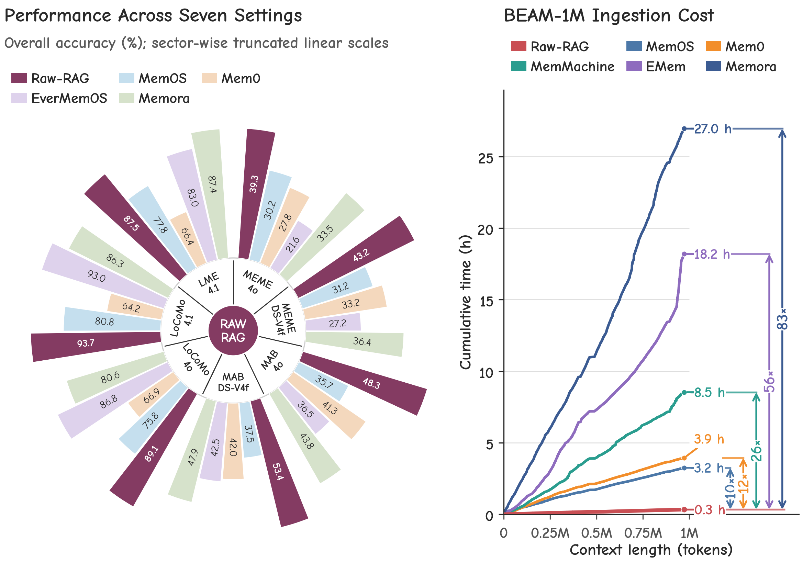

# RAW-RAG: Naive RAG for Long-Term LLM Memory

Implementation and experimental code for **"Is Complex Agentic Memory Always
Needed? Naive RAG Is Stronger Than We Thought"**.

**[Introduction](#introduction) | [Framework](#framework) |
[Results](#evaluation-results) | [Analysis](#what-explains-the-results) |
[Reproduction](#reproduction) | [Citation](#citation)**

## Introduction

Do long-term conversation tasks always require complex agentic memory?
RAW-RAG revisits a simple alternative: **preserve raw history, retrieve relevant
evidence, and let the reader reason over it**.

> **Abstract.** LLM memory is widely used in long-term conversation understanding.
> Agentic memory systems often use mutation, structural organization, learned
> retrieval strategies, or other complex operations. Is this complexity always
> necessary? We study RAW-RAG, a naive RAG baseline using dense retrieval and
> reranking over raw history to supply evidence to a reader LLM. Across LoCoMo,
> LongMemEval, MEME, and MemoryAgentBench, RAW-RAG ranks first among the compared
> memory systems in six of seven benchmark-model settings, outperforming the
> strongest compared agentic memory system by 0.13-5.53 points. We investigate
> why raw-history retrieval remains competitive. Evidence analysis shows that
> its higher coverage of necessary evidence can offset lower utilization.
> Useful evidence includes both answer values and the relations and dependency
> paths needed to derive them. Even complete access to transformed memory stores
> leaves an accuracy gap relative to raw evidence, highlighting the importance
> of preserving raw information. These findings challenge the necessity of
> complex agentic memory for the evaluated conversation tasks and establish
> naive RAG as an essential baseline.

### Key Contributions

1. **Revisit explicit memory mutation.** Capable readers can resolve dynamic
   states from sufficient raw evidence. Disabling UPDATE/DELETE improves
   accuracy in the tested Mem0 configuration.
2. **Establish a strong raw-history baseline.** Dense retrieval plus reranking
   ranks first among the compared memory systems in six of seven settings
   across four benchmarks, without LLM-based memory extraction or organization.
3. **Diagnose evidence loss.** Answer values alone are not enough: temporal
   relations and dependency paths matter. Complete access to a transformed
   memory store does not necessarily recover information preserved in raw history.

## Framework

RAW-RAG uses a fixed **build, retrieve, rerank, read** pipeline:

1. **Build:** serialize conversation history with timestamps and available
   image captions; embed overlapping raw-text windows in a flat index.
   Use a window size of $L$ tokens with an overlap of $O$ tokens.
2. **Retrieve:** embed the question and select the top $K$ windows by cosine
   similarity.
3. **Rerank:** score question-window pairs with a cross-encoder and select the
   top $k$ evidence items, where $k \leq K$.
4. **Read:** supply the selected raw evidence and question to the reader LLM,
   which resolves relevant temporal order and state changes.

The baseline does not use LLM-based fact extraction, summarization, graph
construction, or memory mutation during ingestion. These operations appear
only in separate ablations or external baselines.

The parameters $L$, $O$, $K$, and $k$ are configurable and do not define a
universal context budget.
Benchmark-specific serialization, evidence display, and source-conversion
rules still apply. In particular, $k$ limits the number of selected items,
not necessarily the number of tokens shown to the reader. See
[Match the Paper Configuration](#2-match-the-paper-configuration) before running
an experiment.

## Evaluation Results

The following scores are **reported in the manuscript**, not newly measured
from this checkout. Higher is better; scores and differences are in percentage
points. "Best compared memory system" excludes RAW-RAG and Full-context.

| Benchmark | Reader | RAW-RAG | Best compared memory system | Difference |
| --- | --- | ---: | --- | ---: |
| LoCoMo | GPT-4o-mini | **89.07** | MemMachine (88.12) | +0.95 |
| LoCoMo | GPT-4.1-mini | **93.70** | EverMemOS (93.05) | +0.65 |
| LongMemEval | GPT-4.1-mini | **87.53** | Memora (87.40) | +0.13 |
| MEME | GPT-4o-mini | **39.30** | MemMachine (37.06) | +2.24 |
| MEME | DeepSeek-V4-Flash | 43.19 | **MemMachine (44.71)** | -1.52 |
| MemoryAgentBench | GPT-4o-mini | **48.32** | Memora (43.84) | +4.48 |
| MemoryAgentBench | DeepSeek-V4-Flash | **53.41** | Memora (47.88) | +5.53 |

LoCoMo uses 1,540 non-adversarial questions from 10 conversations; LongMemEval
uses 500 examples. MEME reports the six-task macro-average over 1,188
phase-specific questions from 100 episodes. MemoryAgentBench reports the mean
of four capability macro-averages over 2,071 questions from 14 sources.
PersonaMem-v2 is an additional appendix evaluation, not one of the four
benchmarks behind the six-of-seven headline.

<p align="center">
  
</p>

*The overview figure shows selected comparators and uses sector-wise truncated
scales for accuracy. The table above includes the strongest compared memory
system in each setting.*

**Efficiency.** On the paper's 10-episode, 110-question MEME timing experiment,
RAW-RAG takes 50.32 seconds for add-to-ready and 255.59 seconds for search,
totaling 305.91 seconds. Answer generation and evaluation are excluded.
The figure separately reports cumulative sequential ingestion on BEAM-1M;
these are different timing experiments, not end-to-end serving benchmarks.

**Scope.** These are comparisons under the manuscript's evaluation settings,
not a claim of universal state of the art. RAW-RAG does not lead every task:
on DeepSeek-V4-Flash MEME, MemMachine scores 44.71 and Full-context scores
63.17, compared with RAW-RAG's 43.19. Reader capability, evaluation protocol,
and evidence budget affect the outcome. The supplied configurations must be
checked against the manuscript before attempting to reproduce these scores.

## What Explains the Results?

- **Retrieval quality matters.** Removing reranking reduces MemoryAgentBench
  Total from 48.32 to 44.40 with GPT-4o-mini. Returning only one item reduces it
  by 11.73 points; simply increasing retrieval depth is not always better.
- **More memory processing is not automatically better.** In the same
  MemoryAgentBench ablation, atomic-fact extraction, summary augmentation,
  and graph expansion score 28.70, 42.51, and 42.54, respectively, versus
  48.32 for RAW-RAG.
- **Evidence coverage and utilization are distinct.** A reader may use
  retrieved evidence imperfectly, yet benefit from access to more of the
  information necessary to answer the question.
- **Relations are part of the evidence.** Temporal tracking, deletion,
  cascades, and invalidation require linked events and dependencies, not
  merely isolated mentions of answer values.

The takeaway is to include a well-configured raw-history retrieval baseline
before attributing gains to more complex memory management, not to rule out
agentic memory for other tasks or operating constraints.

## Repository Guide

| Location | Contents |
| --- | --- |
| [`methods/EverCore/evaluation`](methods/EverCore/evaluation) | Evaluation CLI, retrieval adapters, readers, evaluators, and analysis scripts |
| [`methods/EverCore/evaluation/config`](methods/EverCore/evaluation/config) | Dataset, model, prompt, system, and diagnostic configurations |
| [`methods/EverCore/tests`](methods/EverCore/tests) | Regression and integration tests |
| [`scripts`](scripts) | Setup helpers for selected external baselines |
| [`assets`](assets) | Paper figures used in this README |

Benchmark data, credentials, generated indexes, and experiment outputs are
not bundled. Some baselines require separate upstream checkouts or services.

## Reproduction

The steps below retain the full reproduction workflow. The implementation
uses the `rag` system name for RAW-RAG.

### 1. Install

From this directory:

```powershell
cd methods\EverCore
py -3.12 -m venv .venv
.\.venv\Scripts\Activate.ps1
python -m pip install --upgrade pip
python -m pip install -r requirements-eval.txt
# Required once for the LoCoMo F1/BLEU-1 scoring used by minimal-answer profiles.
python -m nltk.downloader punkt_tab
```

`requirements-eval.txt` covers RAW-RAG, its benchmark preparation, reader and
judges. Analysis and offline tests have separate dependency sets:

```powershell
python -m pip install -r requirements-analysis.txt
python -m pip install -r requirements-test.txt
```

Install an additional requirements file only when reproducing the
corresponding local baseline:

```powershell
python -m pip install -r requirements-simplemem.txt
python -m pip install -r requirements-memora-local.txt
```

### 2. Match the Paper Configuration

For RAW-RAG main results and appendix evaluation variants, use the frozen
[paper profiles and PowerShell runner](scripts/paper/README.md).
They cover 15 conditions (including two report-only non-abstention subsets),
with explicit readers, retrieval models, prompts, and judges:

```powershell
# From the package root; preview only, with no file changes or model calls.
pwsh -NoProfile -File scripts/paper/run_rawrag.ps1 -Group All -List
pwsh -NoProfile -File scripts/paper/run_rawrag.ps1 -Group All -DryRun
# Run the seven main conditions, or use -Group All for the appendix as well.
pwsh -NoProfile -File scripts/paper/run_rawrag.ps1 -Group Main
```

`-Group All` also runs both LoCoMo minimal-answer conditions and automatically
reports J/F1/BLEU-1 after their answer/evaluate stages. To score an existing
minimal run without any model calls, run from `methods/EverCore`:

```powershell
python -m evaluation.scripts.score_locomo_lexical `
  --run-dir evaluation/results/locomo-rag-paper-locomo-textemb3-gpt4omini-minimal `
  --with-judge --expected-questions 1540 --expected-judgments 3
```

Repeat with `gpt41mini` for the other reader. Reports are saved as
`lexical_metrics.json` (per-question, category and overall scores) and
`lexical_report.txt`, without modifying saved answers or LLM judgments.
See the [metric definitions and scoring workflow](scripts/paper/README.md#locomo-lexical-reports).

Actual execution permanently replaces the active system, dataset, and prompt
YAML files. It does not back them up, restore them, or check benchmark data.
Run serially in one checkout. Ablations and diagnostics are outside this runner.
The following manual instructions apply to generic runs and other systems;
the profiles supersede them for the named RAW-RAG conditions.

Before every reproduction run, first update:

1. `methods/EverCore/.env`
2. The relevant benchmark YAML file under
   `methods/EverCore/evaluation/config/datasets`
3. The relevant baseline/system YAML file under
   `methods/EverCore/evaluation/config/systems`

Set the API credentials, endpoints, model identifiers, prompts, chunking,
retrieval, context-budget, and evaluator settings to the values used in the
paper. **The configuration files currently included in this package are not
guaranteed to represent the final configurations used for the paper.**
Reproduction is valid only after these files have been checked and, where
necessary, updated.

Create `.env` from the template if needed:

```powershell
Copy-Item .env.example .env
```

At minimum, configure the variables required by the selected system:

```dotenv
LLM_API_KEY=...
LLM_BASE_URL=...
LLM_MODEL=...
VECTORIZE_API_KEY=...
VECTORIZE_BASE_URL=...
VECTORIZE_MODEL=...
RERANK_API_KEY=...
RERANK_BASE_URL=...
RERANK_MODEL=...
RERANK_ENDPOINT=...
```

Do not commit `.env` or API keys.

### 3. Prepare Data

Place the benchmark files under `methods/EverCore/evaluation/data`:

| Benchmark | File or directory |
| --- | --- |
| LoCoMo | `locomo/locomo10.json` |
| LongMemEval-S | `longmemeval/longmemeval_s_cleaned.json` |
| MEME | `meme/meme_filler32k.json` |
| PersonaMem-v2 | `personamem_v2/benchmark/text/benchmark.csv` and `personamem_v2/data/chat_history_32k/*.json` |
| MemoryAgentBench | Source files required by the selected dataset configuration |
| BEAM-1M | Ordered conversations required by the timing experiment |

The dataset YAML files define conversions and benchmark-specific settings.

### 4. Reproduce RAW-RAG

Run from `methods/EverCore`:

```powershell
python -m evaluation.cli --dataset locomo --system rag
python -m evaluation.cli --dataset longmemeval --system rag
python -m evaluation.cli --dataset meme --system rag
python -m evaluation.cli --dataset personamem_v2 --system rag
python -m evaluation.cli --dataset memoryagentbench --system rag
```

The MemoryAgentBench command follows the source selection and chunking defined
in its YAML configuration. RAW-RAG resolves converter defaults independently
for each source: the two fact-consolidation sources use one fact per message,
while other sources retain raw context for token chunking in the adapter.
Explicit converter overrides remain supported. Use the same configuration for the RAW-RAG
ablation systems:

```powershell
python -m evaluation.cli --dataset memoryagentbench --system rag_atomic_facts
python -m evaluation.cli --dataset memoryagentbench --system rag_raw_summary
python -m evaluation.cli --dataset memoryagentbench --system rag_graph_expanded_raw
```

### 5. Reproduce Full-Context Controls

Configure `evaluation/config/systems/full_context.yaml` to match the paper,
then run:

```powershell
python -m evaluation.cli --dataset locomo --system full_context --context-window 128000
python -m evaluation.cli --dataset meme --system full_context --context-window 128000
python -m evaluation.cli --dataset longmemeval --system full_context --context-window 128000
python -m evaluation.cli --dataset memoryagentbench --system full_context --context-window 128000
```

### 6. External Baselines

The baseline YAML files are included, but some upstream implementations and
services must be installed separately. Read and update the matching YAML file
before running each baseline.

```powershell
# SimpleMem
cd ..\..
.\scripts\simplemem\fetch_simplemem.ps1
cd methods\EverCore
python -m pip install -r requirements-simplemem.txt
python -m evaluation.cli --dataset locomo --system simplemem

# Memora
cd ..\..
.\scripts\memora\fetch_memora.ps1
cd methods\EverCore
python -m pip install -r requirements-memora-local.txt
python -m evaluation.cli --dataset locomo --system memora
```

For local MemOS or MemoryOS, start the corresponding service from the package
root, verify that it is ready, and then run the matching system configuration:

```powershell
python -m evaluation.cli --dataset locomo --system memos_local
python -m evaluation.cli --dataset memoryagentbench --system memoryos_local
```

Other systems are selected with their corresponding names in
`evaluation/config/systems`, including `mem0`, `mem0_local`, `emem`, `emem_g`,
`memmachine`, `memu`, `memu_local`, `memos`, `evermemos`, and
`evermemos_local_api`.

### 7. Timing Experiment

For the sequential BEAM-1M ingestion experiment:

```powershell
python -m evaluation.scripts.convert_beam_1m_sequence
python -m evaluation.speed_sequence_cli `
  --system rag `
  --run-name paper-beam-1m `
  --data-dir ..\..\beam\BEAM-1M
```

Use the paper's dataset slice and system YAML configuration.

### 8. Inspect Results

Results are written under `methods/EverCore/evaluation/results`. Inspect:

```powershell
Get-Content evaluation\results\<result-directory>\report.txt
Get-Content evaluation\results\<result-directory>\eval_results.json
```

Before comparing with the paper, verify that the dataset, question count,
reader model, embedding model, reranker, prompts, judge, context budget, and
chunking settings match the paper. Also check that API or answer-generation
failures were not incorrectly counted as correct answers.

LongMemEval reproduction uses the EverMemOS-style judge:

```powershell
python -m evaluation.cli --dataset longmemeval --system rag
```

LongMemEval now preserves complete messages before indexing; the previous
8,000-character loader cap is disabled. Rebuild affected runs before comparing
results. This correction does not retroactively validate or update paper scores.

Reranking is mandatory when enabled. Invalid/missing scores, duplicate indices,
empty responses, and exhausted service retries abort the run instead of
silently falling back to dense retrieval. An intentional embedding-only
ablation must explicitly set `rerank.enabled: false`.

Run identities cover source data, questions, model/configuration settings and
prompts. Changed full-pipeline inputs archive stale downstream artifacts under
`stale_artifacts/` before rebuilding. Per-conversation source fingerprints also
protect the index. Legacy indexes must be rebuilt. The loader
also refreshes converted dataset caches when their raw inputs or converter
implementation change; legacy conversion caches require their original inputs
for this one-time rebuild. A partial-stage invocation
cannot silently adopt incompatible full-pipeline checkpoints. Answer-only
reruns have separate identities tied to the saved evidence and reader settings.

Generic judge failures are recorded in `judge_progress.json` and prevent an
accuracy report. Retrying the same evaluation reuses successful judgments and
retries missing ones. Changing answers, judge settings or prompts prevents
reuse of incompatible judgments. API failures are not incorrect answers.

## Diagnostic Experiments

The diagnostic entry points include
[`build_rag_5k_intervention_runs.py`](methods/EverCore/evaluation/scripts/build_rag_5k_intervention_runs.py)
for 5k evidence controls and
[`run_meme_complete_store_uncapped.py`](methods/EverCore/evaluation/scripts/run_meme_complete_store_uncapped.py)
for complete-store uncapped experiments. Inspect their command-line arguments
and required source artifacts before running them; these are separate
diagnostic conditions, not the default RAW-RAG evaluation.

## Tests

Run the audit regression suite from `methods/EverCore`, without credentials,
benchmark downloads or model calls:

```powershell
python -m pip install -r requirements-test.txt
python -m pytest tests/test_rawrag_regressions.py tests/test_diagnostic_source_manifests.py tests/test_cli_fast_path_filter.py tests/test_longmemeval_official_judge.py tests/test_build_rag_5k_intervention_runs.py tests/test_search_stage_checkpoint.py tests/test_rag_graph_expanded_raw.py tests/test_meme_complete_store_uncapped.py -q
```

The full suite also includes external-baseline integration tests. Install the
corresponding upstream checkouts, GPU and service dependencies before running:

```powershell
python -m pytest tests -q
```

## Citation

This repository accompanies **"Is Complex Agentic Memory Always Needed?
Naive RAG Is Stronger Than We Thought"**. A public paper link and complete
BibTeX entry will be added when the author list and publication metadata are
available.
